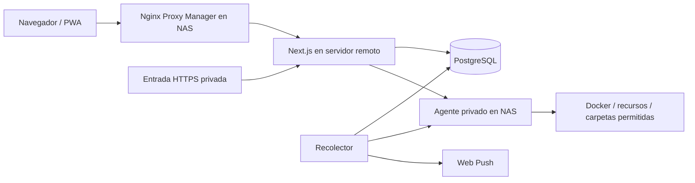

# hub.

Dashboard personal para supervisar y administrar un NAS desde otro servidor. Interfaz en español, adaptable a móvil, con aplicación web instalable.

## Funciones

- CPU, memoria, red, actividad de discos, temperaturas, capacidad y contenedores con datos reales.
- Recogida cada 5 segundos con alguna pestaña visible y cada 30 segundos en segundo plano; historial de 30 días.
- Cuenta personal con Better Auth: correo/contraseña y passkeys. Registro público cerrado después del alta inicial.
- Inicio, parada y reinicio de contenedores; reinicio del NAS con confirmación explícita.
- Explorador limitado a dos carpetas: renombrar, mover, enviar a papelera, restaurar y vaciar. Caducidad de 7 días.
- Avisos internos y Web Push al móvil, con notificación de recuperación y umbrales editables.
- Accesos a servicios y registro de las acciones realizadas.

## Stack

TypeScript 7, React 19, Next.js 16 App Router, Effect 4, PostgreSQL 18, Drizzle, Zod, Tailwind CSS 4, Better Auth, Vitest y Playwright. El agente del NAS usa Python 3.14 y la API de Docker. Las fuentes Manrope y Unbounded se sirven desde la propia aplicación.

Effect gestiona los errores tipados, la cancelación y los tiempos de espera de la comunicación con el NAS. Las acciones de administración no se reintentan automáticamente.

## Arquitectura



Conecta ambos servidores mediante una red privada, por ejemplo Tailscale. El agente valida un token y una lista explícita de IP de origen. No publiques su puerto en Internet. El navegador solo se comunica con Next.js.

## Configuración y despliegue

Requiere Docker y Compose en ambos servidores. El agente necesita Linux, acceso al socket de Docker y montajes de las dos carpetas autorizadas. Estos permisos permiten administrar el NAS: conserva el token exclusivamente en los servidores.

```sh
pnpm install --frozen-lockfile
node scripts/configure.mjs \
  --url https://hub.example.com \
  --nas NAS_TAILSCALE_IP \
  --bind APP_SERVER_TAILSCALE_IP \
  --media /path/to/media \
  --torrents /path/to/torrents
```

Se generan `.env` y `agent/.env` con permisos 0600. No los subas a Git. Puedes configurar un PostgreSQL externo cambiando `DATABASE_URL` y adaptando la dependencia del servicio `db` en Compose.

En el NAS, copia `agent/` y su `.env` y ejecuta:

```sh
cd agent
docker compose up -d --build
```

En el servidor de la aplicación, copia el proyecto y el `.env` de la aplicación:

```sh
docker compose up -d --build
```

Compose aplica las migraciones antes de iniciar la aplicación y el recolector. PostgreSQL utiliza un volumen persistente y no publica su puerto. La aplicación escucha en la IP configurada, puerto 4323, y en `127.0.0.1:4324` para una entrada HTTPS privada alternativa. Mantén una sola réplica web y un solo recolector; un bloqueo de PostgreSQL impide recolectores simultáneos.

Configura Nginx Proxy Manager para dirigir el dominio HTTPS a `APP_SERVER_TAILSCALE_IP:4323`. Conserva la ruta anterior para poder revertir el cambio. Cambiar la ruta no requiere borrar el hub anterior.

Para el alta inicial, abre el dominio con `/#setup=VALOR_DE_SETUP_TOKEN`. El navegador retira el fragmento al cargarlo y el token deja de permitir altas tras crear la primera cuenta. Introduce tu correo y contraseña en la interfaz; después añade las passkeys desde Ajustes.

## Entrada privada alternativa

Puedes publicar `127.0.0.1:4324` mediante Tailscale Serve. Añade la URL HTTPS resultante a `TRUSTED_ORIGINS`, separada por una coma, y recrea la aplicación. Better Auth admite los dominios exactos configurados. Las passkeys pertenecen al dominio principal; en el dominio alternativo utiliza correo y contraseña.

```sh
sudo tailscale serve --bg --https=443 http://127.0.0.1:4324
```

Si el NAS está caído, la entrada privada permite consultar el historial en el servidor remoto. Los datos muestran su antigüedad y los controles se desactivan. El NAS puede tardar hasta 75 segundos en aparecer desconectado.

## Móvil y notificaciones

Añade hub. a la pantalla de inicio. En Ajustes, activa los avisos y envía una prueba. El permiso debe concederse en cada dispositivo. En iPhone se requiere una aplicación añadida a la pantalla de inicio; en Android depende del navegador y sus permisos.

Las claves VAPID se generan con la configuración inicial. La PWA no almacena páginas autenticadas ni respuestas de la API en caché.

## Archivos y operaciones

La papelera se guarda dentro de cada raíz autorizada, en `.hub-trash`, para evitar transferir archivos entre servidores. Su contenido sigue ocupando espacio. El agente elimina los elementos caducados cada hora y al arrancar. Nunca sobrescribe un destino al mover o restaurar, y bloquea rutas absolutas, escapes con `..` y enlaces simbólicos.

Los movimientos se realizan dentro de la raíz seleccionada. No se permiten transferencias entre las dos raíces, subidas ni comandos arbitrarios. NPM, Tailscale y el agente están protegidos frente a paradas desde la interfaz. Cambia `PROTECTED` en el agente si los nombres de tus contenedores son distintos.

Si se pierde una respuesta durante una operación, queda pendiente de verificar. Comprueba el estado antes de repetirla. El reinicio del NAS utiliza un contenedor auxiliar privilegiado con un comando fijo; no se expone una consola remota.

## Desarrollo y pruebas

Crea `.env.local` con un PostgreSQL local y las variables del ejemplo. Usa `BETTER_AUTH_URL=http://localhost:3000` y el mismo valor en `TRUSTED_ORIGINS`.

```sh
pnpm db:migrate
pnpm dev
# En otro terminal:
pnpm worker

pnpm typecheck
pnpm lint
pnpm test
pnpm test:agent
pnpm build
pnpm exec playwright install chromium
pnpm test:e2e
```

Playwright usa una base de datos de desarrollo/pruebas, crea una cuenta de prueba cuando está vacía y comprueba acceso, registro cerrado, origen de peticiones, navegación, móvil y passkeys con un autenticador virtual. No apuntes estas pruebas a producción. Los tests del agente utilizan archivos temporales; las operaciones `renameat2` requieren Linux.

TypeScript 7 compila la aplicación. ESLint todavía requiere la API JavaScript de TypeScript 6, instalada mediante el alias `typescript-api` y cargada solo en el proceso de lint. Se puede retirar ese adaptador cuando typescript-eslint admita TypeScript 7.

Dependabot revisa paquetes, Docker y GitHub Actions semanalmente. CI ejecuta tipos, lint, tests, migraciones, build y Playwright.

## Copias y recuperación

Haz copias del PostgreSQL, del `.env` de ambos servidores y de las carpetas del NAS. La papelera no sustituye a una copia de seguridad. Para recuperar el acceso si pierdes contraseña y passkeys, accede por SSH al servidor y usa el comando administrativo documentado en `scripts/reset-password.ts`; las sesiones existentes se revocan.
