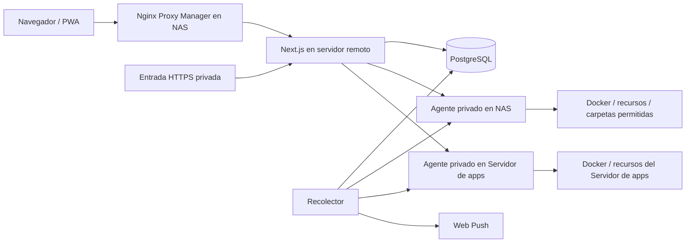

# hub.

Dashboard personal para supervisar y administrar un NAS desde otro servidor. Interfaz en español, adaptable a móvil, con aplicación web instalable.

## Funciones

- CPU total y por núcleo, carga, memoria y swap, red por interfaz, actividad y latencia de discos, RAID, temperaturas, capacidad y contenedores con datos reales.
- Varios hosts con estado de conexión independiente: el NAS y el Servidor de apps. Mantenimiento cambia de host sin perder el resto del panel.
- Recogida cada 5 segundos con alguna pestaña visible y cada 30 segundos en segundo plano; historial de 30 días.
- Cuenta personal con Better Auth: correo/contraseña y passkeys. Registro público cerrado después del alta inicial.
- Inicio, parada y reinicio de contenedores; enlace a la página de cada servicio, versión de su imagen y actualización con aviso previo; reinicio del NAS con confirmación explícita.
- Explorador limitado a dos carpetas: renombrar, mover, enviar a papelera, restaurar y vaciar. Caducidad de 7 días.
- Avisos internos y Web Push al móvil, con notificación de recuperación y umbrales editables.
- Accesos a servicios y registro de las acciones realizadas.

## Stack

TypeScript 7, React 19, Next.js 16 App Router, Effect 4, PostgreSQL 18, Drizzle, Zod, Tailwind CSS 4, Better Auth, Vitest y Playwright. El agente del NAS usa Python 3.14 y la API de Docker. Las fuentes Manrope y Unbounded se sirven desde la propia aplicación.

Effect gestiona los errores tipados, la cancelación y los tiempos de espera de la comunicación con el NAS. Las acciones de administración no se reintentan automáticamente.

## Arquitectura



Conecta ambos servidores mediante una red privada, por ejemplo Tailscale. El agente valida un token y una lista explícita de IP de origen. No publiques su puerto en Internet. El navegador solo se comunica con Next.js.

El hub lee la lista de agentes de `NAS_HOSTS`: identificador, nombre, rol (`instance` o `apps-server`), URL y token. Cada host tiene su propio historial, avisos, operaciones y umbrales. Las instalaciones de un solo agente siguen funcionando con `NAS_AGENT_URL` y `AGENT_TOKEN`; en ese caso el host se llama `nas-home`. Conserva ese identificador en el NAS para que la migración encuentre el historial existente.

## Configuración y despliegue

Requiere Docker y Compose en ambos servidores. El agente del NAS necesita Linux, acceso al socket de Docker y montajes de las dos carpetas autorizadas; el del Servidor de apps solo necesita el socket y los recursos del sistema. Estos permisos permiten administrar los servidores: conserva los tokens exclusivamente en ellos.

```sh
pnpm install --frozen-lockfile
node scripts/configure.mjs \
  --url https://hub.example.com \
  --nas NAS_TAILSCALE_IP \
  --bind APP_SERVER_TAILSCALE_IP \
  --media /path/to/media \
  --torrents /path/to/torrents \
  --apps-url http://hub-agent-apps:9450
```

Se generan `.env`, `agent/.env` y `agent/.env.apps` con permisos 0600. No los subas a Git. Omite `--apps-url` para un único host. Puedes configurar un PostgreSQL externo cambiando `DATABASE_URL` y adaptando la dependencia del servicio `db` en Compose.

En el NAS, copia `agent/` y su `.env` y ejecuta:

```sh
cd agent
docker compose up -d --build
```

En el servidor de la aplicación, copia el proyecto y el `.env` de la aplicación:

```sh
docker compose up -d --build
```

El agente del Servidor de apps comparte máquina con el hub. Usa su propio `.env.apps`, se une a la red privada `nas-dashboard_default` y no publica puertos. No monta las carpetas multimedia, no permite reiniciar la máquina y protege los contenedores del hub:

```sh
cd agent
docker compose --env-file .env.apps -f compose.apps.yaml up -d --build
```

La instantánea de Mantenimiento monta en solo lectura el checkout y el estado de media-stack. Configura `MEDIA_STACK_CHECKOUT_PATH` y `MEDIA_STACK_APPDATA_PATH` en el NAS; en el Servidor de apps usa `--apps-stack-path` y `--apps-appdata-path` al generar la configuración. La imagen del agente incluye `smartctl` y lee los discos del host a través del contenedor auxiliar, sin instalar nada en el NAS ni ejecutar acciones sobre los discos. El contrato completo está en `agent/MAINTENANCE.md`; las métricas nativas y sus unidades, en `agent/METRICS.md`.

El agente del NAS también escribe los ajustes que faltan de una release retenida. Para hacerlo sin montar el checkout con escritura, el `.env` real vive en un directorio dedicado (`MEDIA_STACK_ENV_PATH`, `/volume2/media-stack-env` por defecto) y el checkout lo enlaza:

```sh
sudo install -d -m 0700 /volume2/media-stack-env
sudo mv /volume2/media-stack/.env /volume2/media-stack-env/.env
sudo ln -s /volume2/media-stack-env/.env /volume2/media-stack/.env
```

El agente monta solo ese directorio con `:rw`, donde crea la copia previa y reemplaza el `.env` con `rename` atómico. El Servidor de apps no monta este directorio y rechaza la escritura.

Compose aplica las migraciones antes de iniciar la aplicación y el recolector. PostgreSQL utiliza un volumen persistente y no publica su puerto. La aplicación escucha en la IP configurada, puerto 4323, y en `127.0.0.1:4324` para una entrada HTTPS privada alternativa. Mantén una sola réplica web y un solo recolector; un bloqueo de PostgreSQL impide recolectores simultáneos. La migración de varios hosts asigna las muestras, avisos, operaciones y ajustes existentes al host `nas-home`.

Configura Nginx Proxy Manager para dirigir el dominio HTTPS a `APP_SERVER_TAILSCALE_IP:4323`. Conserva la ruta anterior para poder revertir el cambio. Cambiar la ruta no requiere borrar el hub anterior.

Para el alta inicial, abre el dominio con `/#setup=VALOR_DE_SETUP_TOKEN`. El navegador retira el fragmento al cargarlo y el token deja de permitir altas tras crear la primera cuenta. Introduce tu correo y contraseña en la interfaz; después añade las passkeys desde Ajustes.

### Validación de configuración al arrancar

`pnpm start` ejecuta `scripts/check-runtime-config.ts` antes de `next start`. El preflight carga el mismo entorno que usa Next en producción mediante `@next/env`: primero el entorno del proceso y después `.env.production.local`, `.env.local`, `.env.production` y `.env`, en ese orden. Si falta una variable obligatoria, se conserva un valor de ejemplo o un grupo opcional queda incompleto, el proceso termina con error y `next start` no llega a ejecutarse. `pnpm build` no ejecuta esta comprobación: la imagen se compila con un secreto de build separado y el secreto real solo se exige al arrancar. La sonda de Compose sigue consultando `/api/setup`; el preflight no la sustituye.

Variables obligatorias: `DATABASE_URL` (PostgreSQL, con usuario, contraseña y base), `BETTER_AUTH_SECRET` y `SETUP_TOKEN` (mínimo 32 caracteres y distintos de los valores de ejemplo), `BETTER_AUTH_URL` (HTTPS, o HTTP solo en loopback para desarrollo, sin usuario, contraseña, ruta, consulta ni fragmento) y `NAS_HOSTS` o la pareja `NAS_AGENT_URL`/`AGENT_TOKEN`. `TRUSTED_ORIGINS` es opcional; si se define, cada origen se valida con las mismas reglas.

Telegram es opcional: define `TELEGRAM_BOT_TOKEN` y `TELEGRAM_CHAT_ID` juntos o deja ambos sin definir. El chat debe ser numérico (admite signo negativo para supergrupos). `PUSH_WARNINGS` solo acepta `true` o `false` y vale `false` por omisión; si se activa, `VAPID_PUBLIC_KEY` y `VAPID_PRIVATE_KEY` son obligatorias y deben formar un par coherente. Los diagnósticos nombran la variable y un motivo finito, nunca su valor.

### Despliegue conjunto de la fase 2

La fase 2 se despliega como una unidad después de completar la ola 5. No actives Telegram ni `PUSH_WARNINGS` por olas, y no cambies ni actives los emisores de `media-stack` en esta fase.

1. **Para la app y el worker antiguos.** El código anterior consulta `alerts` por nombre; un worker vivo durante la migración puede escribir con el esquema a medias. Detén ambos servicios antes de migrar.
2. **Guarda una copia restaurable.** Base completa (o los esquemas `public` y `drizzle`) y el `.env` del servidor. Conserva también `drizzle.__drizzle_migrations`: la reversa depende de su última entrada.
3. **Mide el preflight de solo lectura.** Antes de 0004, sobre `alerts`:

   ```sql
   SELECT count(*) FROM alerts;
   SELECT count(*) FROM alerts WHERE "resolvedAt" IS NULL;
   SELECT "hostId", key, count(*)
   FROM alerts
   WHERE "resolvedAt" IS NULL
   GROUP BY "hostId", key
   HAVING count(*) > 1;
   SELECT max(id) FROM alerts;
   ```

   Anota los recuentos. Después de 0004, repite las consultas sobre `incidents` y comprueba que `notification_outbox` e `incident_events` están vacías. El ensayo de 02-01 (`HUB_REQUIRE_TEST_DB=1 pnpm test tests/migrations.test.ts`) ejecuta 0003 → 0004 → reversa → 0004 en PostgreSQL 18 y es la referencia de los recuentos esperados.
4. **Migra y arranca.** Ejecuta `pnpm db:migrate` y después arranca las versiones nuevas de `app` y `worker`. El preflight de configuración se ejecuta en cada arranque.
5. **Activa los canales juntos.** Cuando la ola 5 esté desplegada, define el grupo de Telegram completo y, si quieres push para avisos no urgentes, el par VAPID con `PUSH_WARNINGS=true`. Recrea `app` y `worker` para que ambos lean la misma configuración.

**Reversa.** Detén `app` y `worker`. Si hubo actividad después de 0004, archiva antes las filas nuevas de `notification_outbox` (resultados, chat, `message_id`, lease y revisión) y de `incident_events` (timeline): la reversa elimina esas tablas y no las exporta. Después ejecuta:

```sh
psql "$DATABASE_URL" -v ON_ERROR_STOP=1 -f scripts/rollback/0004_incidents.sql
```

El script comprueba que 0004 es el último avance del journal, elimina el índice parcial, restaura solo los cierres sintéticos de la migración y conserva los cierres válidos y los identificadores. Arranca entonces la versión anterior. Si necesitas recuperar también la actividad posterior a 0004 (outbox, eventos y marcas de entrega), restaura la copia completa tomada antes de migrar en lugar de confiar solo en el script; la copia es la única que conserva esos datos. Para volver a avanzar, aplica de nuevo `pnpm db:migrate` con la versión nueva: los identificadores se conservan y los duplicados se vuelven a deduplicar.

## Entrada privada alternativa

Puedes publicar `127.0.0.1:4324` mediante Tailscale Serve. Añade la URL HTTPS resultante a `TRUSTED_ORIGINS`, separada por una coma, y recrea la aplicación. Better Auth admite los dominios exactos configurados. Las passkeys pertenecen al dominio principal; en el dominio alternativo utiliza correo y contraseña.

```sh
sudo tailscale serve --bg --https=443 http://127.0.0.1:4324
```

Si el NAS está caído, la entrada privada permite consultar el historial en el servidor remoto. Los datos muestran su antigüedad y los controles se desactivan. El NAS puede tardar hasta 75 segundos en aparecer desconectado.

## Cabeceras de seguridad

HSTS lo emite la propia aplicación, no el proxy. Toda respuesta lleva `Strict-Transport-Security: max-age=15552000` (180 días), sin `includeSubDomains` ni `preload`: el dominio principal comparte nombre con otros servicios del NAS, incluir subdominios los afectaría a todos y `preload` es prácticamente irreversible. Al emitirse en la aplicación, la cabecera cubre por igual el dominio principal (Nginx Proxy Manager) y la entrada alternativa de Tailscale Serve, sin configurar dos veces el mismo valor.

Deja apagado el interruptor «HSTS Enabled» de Nginx Proxy Manager. Si el proxy también emite la cabecera, el navegador recibe dos y solo respeta la primera; la aplicación ya la envía y duplicarla no aporta nada.

HSTS solo tiene efecto sobre HTTPS: los navegadores ignoran la cabecera servida por HTTP, así que verla en `http://localhost` durante el desarrollo es inocuo. Para comprobar la respuesta de cada dominio:

```sh
curl -sI https://hub.example.com | grep -i strict-transport-security
curl -sI https://hub-alternativo.tailnet.example | grep -i strict-transport-security
```

Cada uno debe devolver una sola línea con `max-age=15552000` y sin `includeSubDomains` ni `preload`.

La CSP se aplica en dos capas. Los documentos (login, panel y 404) reciben desde `src/proxy.ts` una política con un nonce nuevo por petición y `'strict-dynamic'`, sin `'unsafe-inline'` en `script-src`, con `object-src 'none'`, `base-uri 'self'`, `form-action 'self'`, `connect-src 'self'` y `frame-ancestors 'none'`. Las respuestas de la API llevan su propia política mínima, `default-src 'none'; frame-ancestors 'none'`, declarada en `next.config.ts`; los documentos no la reciben. Para revertir la CSP de documentos basta con borrar `src/proxy.ts`; el HSTS y la CSP de la API seguirían declarados en `next.config.ts`. La política conserva `style-src 'unsafe-inline'` porque el panel serializa atributos `style` con anchos dependientes de datos.

## Límites de cuerpo y de respuesta

**Cuerpo de las mutaciones.** El hub lee el cuerpo de cada mutación con un lector acotado que corta en streaming, sin fiarse solo de `Content-Length`. El tope es de 16 KiB por defecto, de 64 KiB en los ajustes de despliegue y de 32 KiB en las rutas de autenticación (`POST /api/auth/*`). Un cuerpo mayor responde `413` y no deja operación, incidencia ni línea de log.

**Respuesta del agente.** Todo lo que el hub lee de un agente pasa por un único lector acotado en `nasEffectForHost` (`src/lib/nas.ts`). Si la respuesta declara un `Content-Length` por encima del tope de su camino no se lee; si no lo declara se lee en streaming y se corta al pasar el tope. Los topes están en `AGENT_RESPONSE_LIMITS`:

| Camino | Tope |
| --- | --- |
| `/metrics` | 2 MiB |
| `/maintenance` | 1 MiB |
| `/deployments` | 2 MiB |
| `/files` | 8 MiB |
| `/trash` | 2 MiB |
| `/logs` | 8 MiB |
| Respuesta a un `POST` | 256 KiB |
| Cualquier otro | 1 MiB |

Al superar el tope la ruta responde `502` con `code: "agent_response_too_large"` y un mensaje fijo, nunca datos parciales. La vista conserva el último dato válido y muestra el error (el estado de mantenimiento queda marcado como obsoleto y el listado de archivos mantiene las entradas de la misma carpeta). El colector lo trata como un contrato roto: no escribe muestra, no resuelve incidencias y no cuenta como desconexión. Si un `POST` ya ejecutado devuelve una respuesta demasiado grande, el resultado queda pendiente de verificar, igual que una respuesta ilegible.

Limitación conocida: un directorio con más entradas de las que caben en 8 MiB no podrá listarse con el tope actual, porque el agente aún no pagina el listado. Los valores de los topes son suposiciones sin medir; se revisan con los tamaños reales de `/metrics`, `/files` y `/logs` en producción, y bajar el tope de 64 MiB de los logs del agente y paginar el listado son tareas posteriores.

**Acciones protegidas.** La lista de acciones, comandos y rutas que exigen una verificación reciente vive en `src/lib/sensitive-actions.ts` y es la única que leen el servidor y la interfaz. La ventana de verificación es de 5 minutos. Una acción, comando o ruta nuevos deben declararse allí: una prueba falla si no lo están.

## Móvil y notificaciones

Añade hub. a la pantalla de inicio. En Ajustes, activa los avisos y envía una prueba. El permiso debe concederse en cada dispositivo. En iPhone se requiere una aplicación añadida a la pantalla de inicio; en Android depende del navegador y sus permisos.

Las claves VAPID se generan con la configuración inicial. La PWA no almacena páginas autenticadas ni respuestas de la API en caché.

## Archivos y operaciones

La papelera se guarda dentro de cada raíz autorizada, en `.hub-trash`, para evitar transferir archivos entre servidores. Su contenido sigue ocupando espacio. El agente elimina los elementos caducados cada hora y al arrancar. Nunca sobrescribe un destino al mover o restaurar, y bloquea rutas absolutas, escapes con `..` y enlaces simbólicos. El agente del Servidor de apps se configura con `FILES_ENABLED=false`: Mantenimiento muestra sus contenedores y recursos, pero Archivos sigue usando el NAS.

Los movimientos se realizan dentro de la raíz seleccionada. No se permiten transferencias entre las dos raíces, subidas ni comandos arbitrarios. NPM, Tailscale y los agentes están protegidos frente a paradas desde la interfaz. Añade nombres de contenedores a `PROTECTED_CONTAINERS` si quieres bloquear otros servicios.

Si se pierde una respuesta durante una operación, queda pendiente de verificar. Comprueba el estado antes de repetirla. El reinicio del NAS utiliza un contenedor auxiliar privilegiado con un comando fijo; no se expone una consola remota.

## PR de Renovate

El hub puede leer las PR abiertas de Renovate en `alberba/media-stack` sin modificar GitHub. El servidor guarda un token *fine-grained* limitado a ese repositorio con permisos de lectura de *Pull requests*, *Contents* y *Checks*; el token nunca llega al navegador ni a los agentes. Configúralo en el `.env` del servidor:

```sh
GITHUB_TOKEN=github_pat_...
GITHUB_REPOSITORY=alberba/media-stack
```

Si falta `GITHUB_TOKEN`, la sección de Renovate se desactiva sin llamar a GitHub y sin mostrar errores. Solo se listan PR de autor Renovate en ramas `renovate/*` que cambian imágenes de Compose. Cada actualización se relaciona con los contenedores por las etiquetas `com.docker.compose.project` y `com.docker.compose.service` que envía el agente, no por la cadena de la imagen: los pins de seguridad, las versiones retenidas, las imágenes locales y las imágenes sin etiqueta siguen apuntando a su servicio. Las PR agrupadas de Tdarr incluyen el nodo del Worker y se marcan como «requiere Worker». Esta fase es de solo lectura: no fusiona PR ni modifica GitHub.

## Desarrollo y pruebas

Crea `.env.local` con un PostgreSQL local y las variables del ejemplo. Usa `BETTER_AUTH_URL=http://localhost:3000` y el mismo valor en `TRUSTED_ORIGINS`. Puedes configurar `NAS_HOSTS` con uno o varios agentes, o mantener `NAS_AGENT_URL` y `AGENT_TOKEN` para un único NAS.

```sh
pnpm db:migrate
pnpm dev
# En otro terminal:
pnpm worker

pnpm typecheck
pnpm lint
pnpm test
pnpm test:agent
pnpm test:audit
pnpm audit:noise -- --export "/ruta/absoluta/al/messages.html"
pnpm build
pnpm exec playwright install chromium
pnpm test:e2e
```

Playwright usa una base de datos de desarrollo/pruebas, crea una cuenta de prueba cuando está vacía y comprueba acceso, registro cerrado, origen de peticiones, navegación, móvil y passkeys con un autenticador virtual. No apuntes estas pruebas a producción. Los tests del agente utilizan archivos temporales; las operaciones `renameat2` requieren Linux.

La auditoría del ruido de Telegram (`scripts/audit/`) usa solo la biblioteca estándar de Python 3: no instala dependencias ni toca `pnpm-lock.yaml`. `pnpm audit:noise -- --export` recibe la ruta absoluta al `messages.html` exportado, que vive fuera del repositorio y no se copia aquí; el NDJSON normalizado se escribe en `/tmp/noise-audit/messages.ndjson` y el JSON de agregados de la fase en `.planning/phases/01-auditor-a-del-ruido/01-AUDIT.json`.

TypeScript 7 compila la aplicación. ESLint todavía requiere la API JavaScript de TypeScript 6, instalada mediante el alias `typescript-api` y cargada solo en el proceso de lint. Se puede retirar ese adaptador cuando typescript-eslint admita TypeScript 7.

Dependabot revisa paquetes, Docker y GitHub Actions semanalmente. CI ejecuta tipos, lint, tests, migraciones, build y Playwright.

## Copias y recuperación

Haz copias del PostgreSQL, del `.env` de ambos servidores y de las carpetas del NAS. La papelera no sustituye a una copia de seguridad. Para recuperar el acceso si pierdes contraseña y passkeys, accede por SSH al servidor y usa el comando administrativo documentado en `scripts/reset-password.ts`; las sesiones existentes se revocan.

Las pruebas Python del agente necesitan `python -m pip install -r agent/requirements.txt` en un entorno virtual. Docker y CI usan ese mismo archivo.
